# LabSafe Virtual Labs

A browser-based virtual engineering laboratory for first-year B.Tech students. It
provides a navigable 3D campus, guided experiments in chemistry, electronics and
IT workshop, browser simulations with recorded observations, server-graded
assessments, and institution-controlled access.

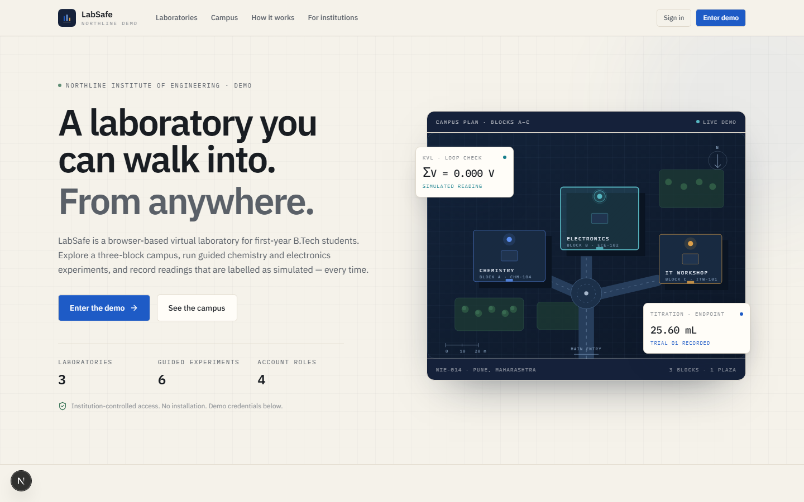

## Highlights

- **3D campus navigation** — explore a WebGL campus with lab markers and
  camera presets, then step directly into a laboratory.
- **Guided experiments** — step-by-step procedures for acid–base titration,
  Kirchhoff's laws, and PC hardware study, with live simulations.
- **Browser simulations** — interactive titration, circuit, and hardware
  teardown simulations that record observations into a structured table.
- **Server-graded assessments** — quizzes graded on the server with feedback
  and explanations.
- **Institution portal** — student directory, equipment board, and results
  management for administrators, instructors, and technicians.
- **Role-based access** — students, pending students, administrators,
  instructors, and technicians, scoped to Northline Institute.
- **Demo-ready** — file-backed repository seeded on first run, no database
  required.

## Tech stack

- Next.js 16 (App Router) · React 19 · TypeScript
- Tailwind CSS 4
- `@react-three/fiber`, `@react-three/drei`, `three` for the 3D campus and
  interactive models
- Zustand for client state
- File-backed demo repository (`.data/labsafe-demo.json`), seeded on first run

## Screenshots

### Landing & authentication

| Landing | Sign-in |
| --- | --- |
|  | 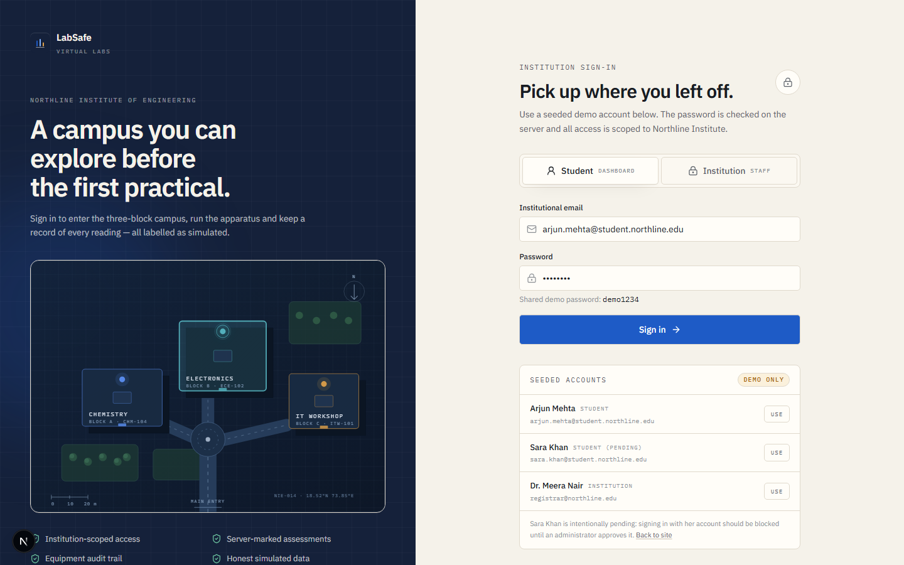 |

### Student experience

| Dashboard | 3D campus |
| --- | --- |
| 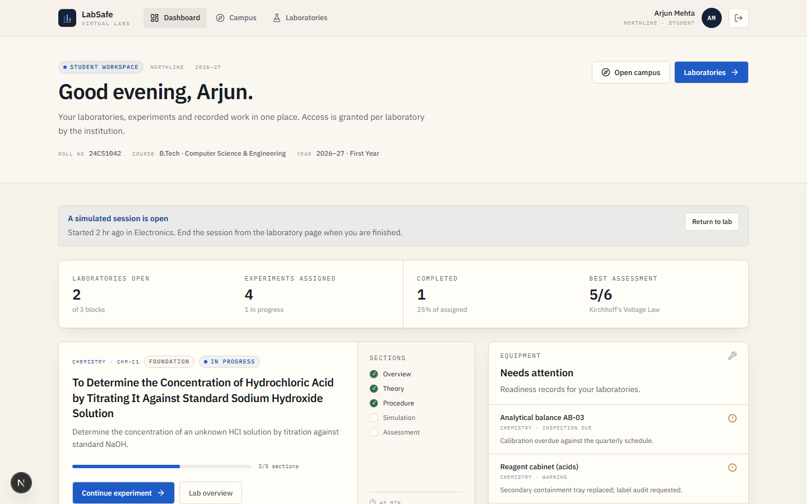 | 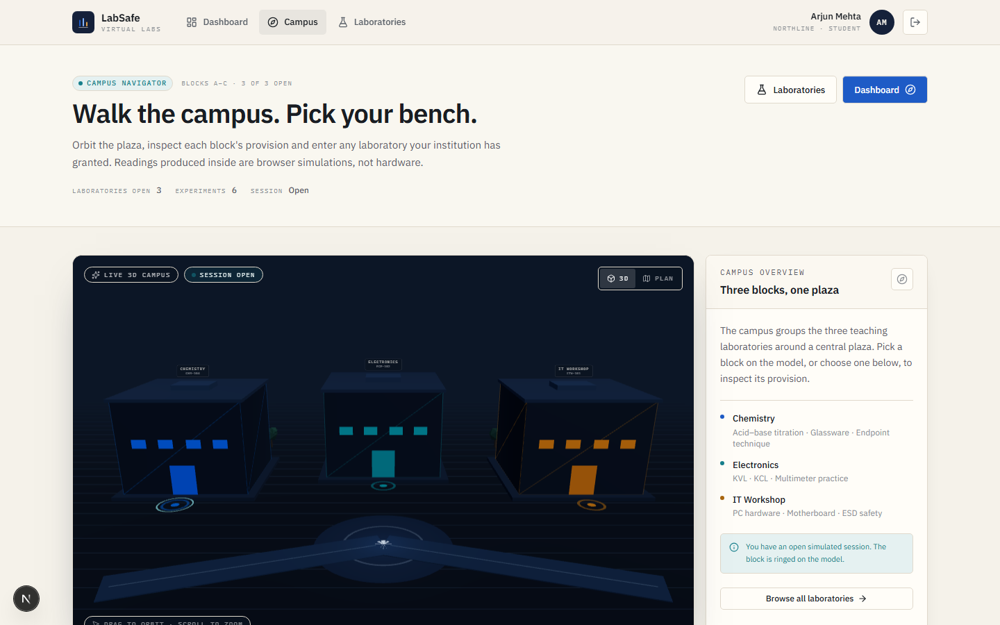 |

| Laboratory overview | Experiment workspace |
| --- | --- |
| 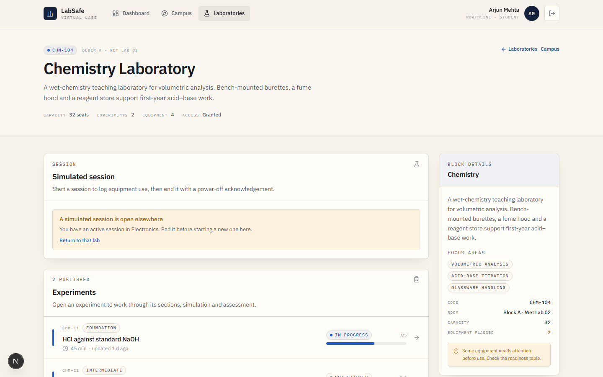 | 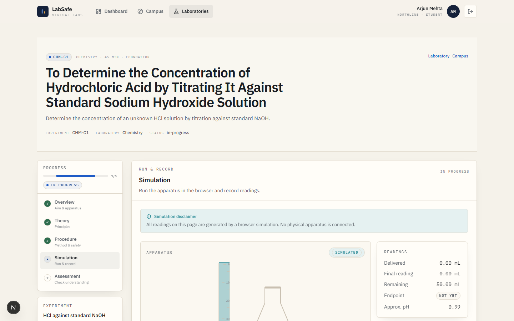 |

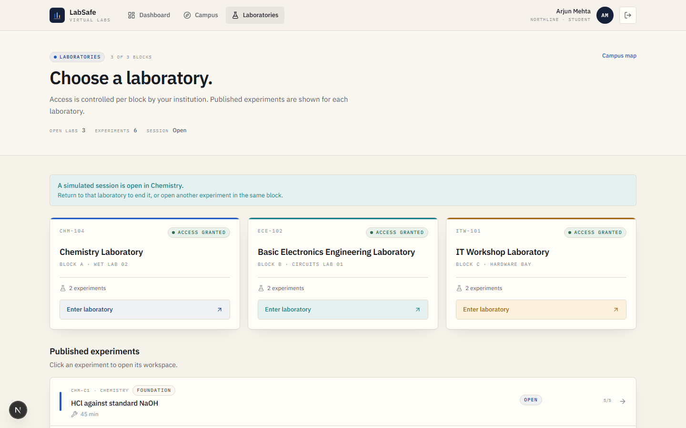

### Institution portal

| Dashboard | Student directory |
| --- | --- |
| 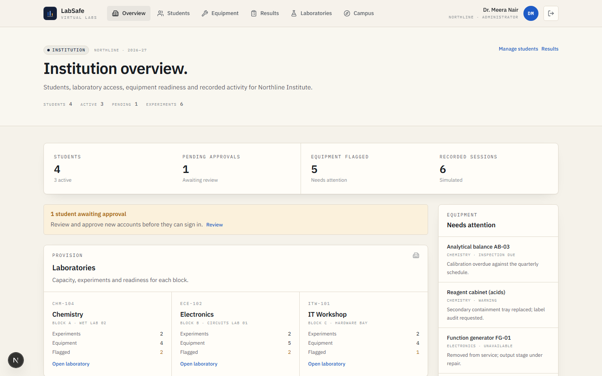 | 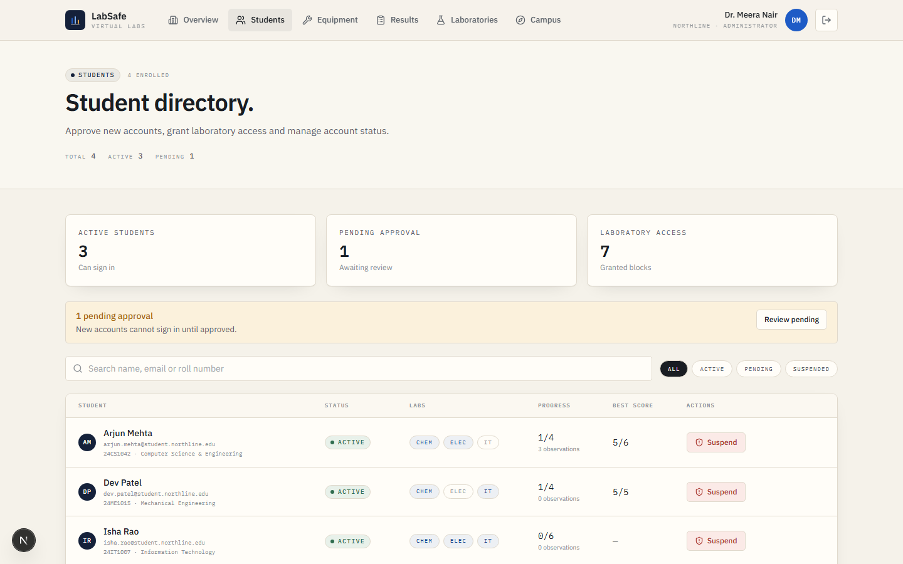 |

| Equipment board | Results |
| --- | --- |
| 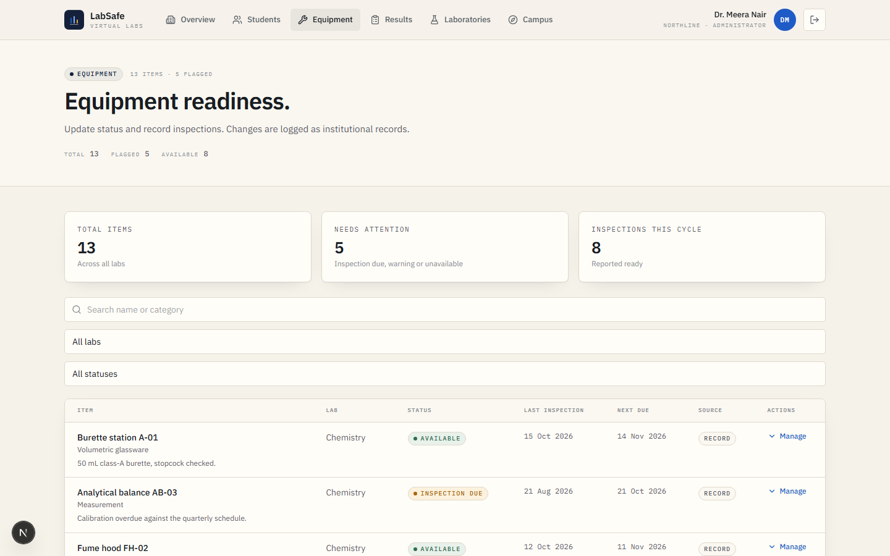 | 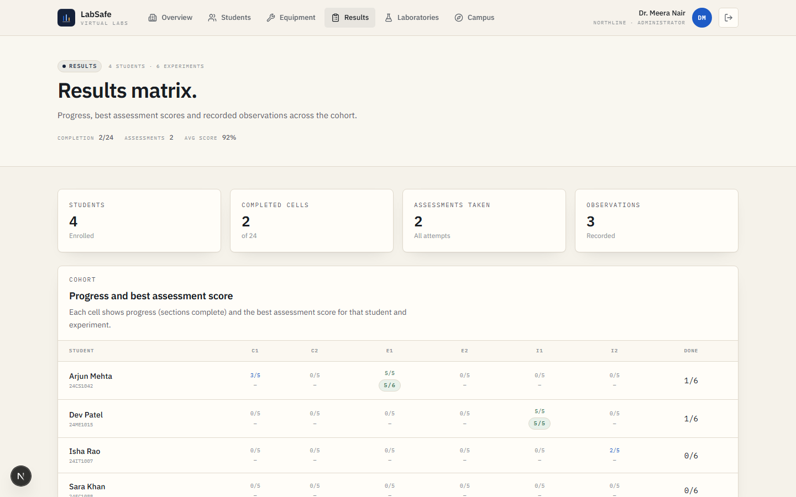 |

## Getting started

```bash
npm install
npm run dev
```

Open http://localhost:3000.

## Demo accounts

Shared password: `demo1234`

| Role | Email |
| --- | --- |
| Student | arjun.mehta@student.northline.edu |
| Student (pending) | sara.khan@student.northline.edu |
| Administrator | registrar@northline.edu |

Students go to `/dashboard`; staff go to `/institution`. Sara Khan is
intentionally pending — signing in with her account is blocked until an
administrator approves it.

## Scripts

- `npm run dev` — development server
- `npm run build` — production build
- `npm run start` — production server
- `npm run typecheck` — TypeScript check
- `npm run lint` — lint

## Project structure

```
src/
  app/            # Next.js App Router pages and layouts
  components/     # Shared UI, campus, three.js helpers
  features/       # Feature modules (auth, labs, simulations, institution)
  lib/            # Auth, data repository, utilities
  types/          # Shared TypeScript types
docs/
  screenshots/    # UI/UX captures used in this README
```

## Notes

- All readings produced by the simulations are labelled as simulated. No
  physical apparatus is connected and no chemicals are present.
- The repository is a demo stand-in. Replace `src/lib/data/repository.ts` with a
  real database for production use.
- `.data/` is gitignored and is created and seeded on first run.
- Do not commit secrets; `LABSAFE_SESSION_SECRET` may be set in production.